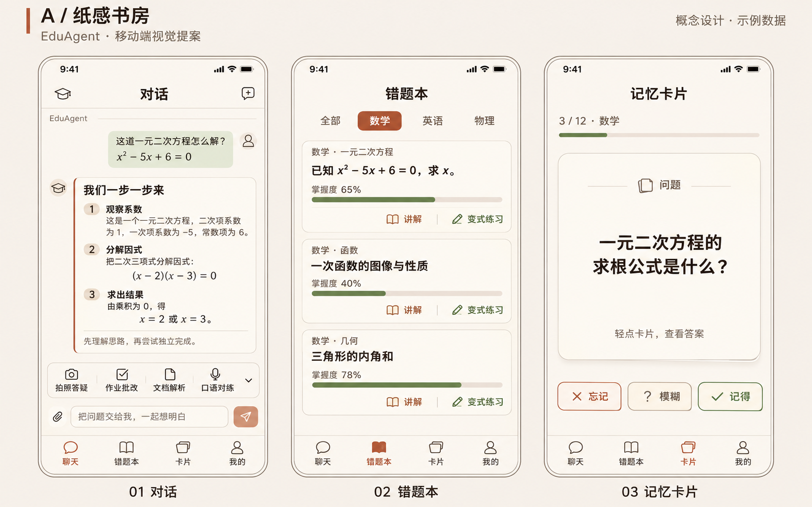
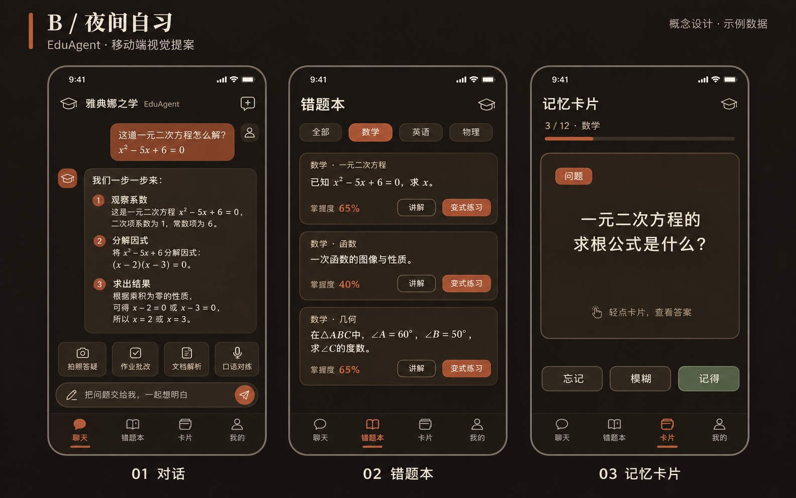
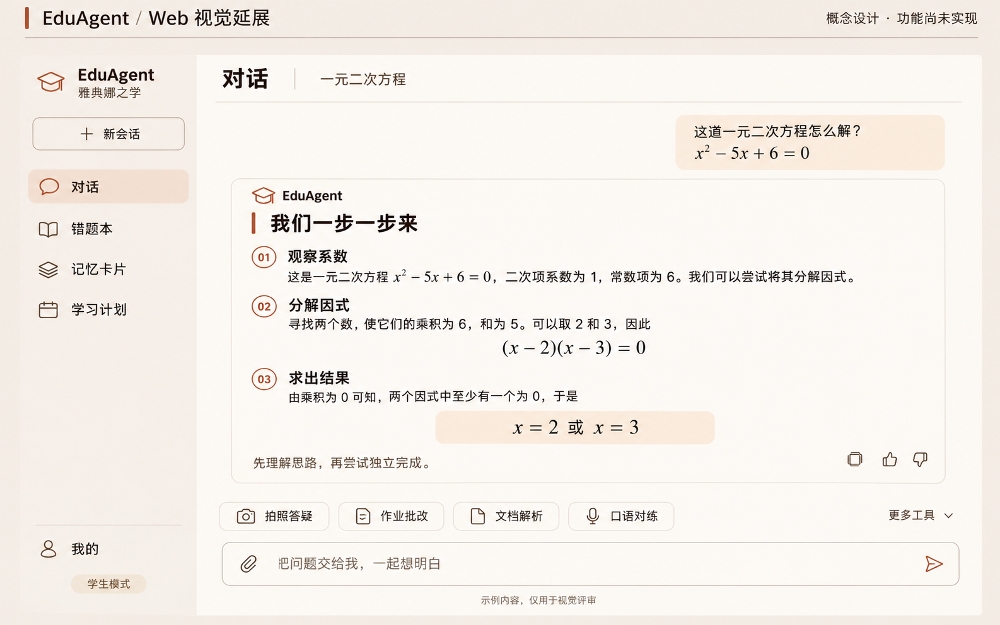

# EduAgent 前端美化提案

状态：仅供视觉评审，尚未实施或上线。日期：2026-11-03。

## 预览

## 交付

- A「纸感书房」：移动端浅色方案，覆盖对话、错题本、记忆卡片；推荐作为默认方向。
- B「夜间自习」：移动端深色方案，使用相同功能与内容，便于比较阅读体验。
- Web 视觉延展：将现有移动端功能映射到桌面布局的概念稿。当前 website 仍是初始化模板，图中页面未实现。
- 图中题目、掌握度和复习数量均为演示数据。最终文案、图标及尺寸应在实施时按真实组件复核。

## 设计取舍

A 延续当前代码中的暖米白纸面、墨褐文字、赤陶强调色，强化段落与公式层级，减少密集工具的视觉竞争。B 使用现有暖炭黑深色令牌，让卡片、正文和背景保持可辨层次。两个方向可以作为同一套系统的浅色和深色模式。

| 元素 | 浅色方向 A | 深色方向 B |
| --- | --- | --- |
| 背景 | #F6F2EB | #1D1915 |
| 卡片 | #FDFBF5 | #282219 |
| 正文 | #26201A | #EDE6D8 |
| 边框 | #E2DACD | #3D362B |
| 主要强调 | #C15F3C | #C15F3C；小号文字按对比度调整 |

标题沿用 HarmonyOS Sans SC，正文保持易读的系统字体；建议正文 16–17、行高约 1.5，间距采用 8 的倍数，卡片圆角以 10–16 为主。上述尺寸为实施建议，生成图不构成像素级规格。

对话突出解题步骤与公式；错题本突出学科、题目、掌握度和既有操作；记忆卡片突出问题与「忘记／模糊／记得」。保留学生端既有导航，教师专属功能不放入学生示意图。语音录制是现有规范允许的渐变与光晕签名元素，本轮三种核心屏幕不增加此类装饰。

## 动效与 C++ 渲染路线（待决定后才实施）

本轮仅制定路线，没有构建或接入渲染引擎，也没有测得运行时卡顿。

Flutter 引擎本身主要用 C++ 编写；移动端优先复用现有引擎。若确认复杂自绘是瓶颈，再评估用 C++ 实现局部渲染模块及其接入方式，而不是因视觉改版直接重写整套引擎。[Flutter 官方架构说明](https://docs.flutter.dev/resources/architectural-overview)

若将来 Web 端出现确实需要的重计算或复杂绘制，可评估把 C++ 模块编译为 WebAssembly，再与浏览器绘制接口配合；这是备选技术路径，不能据此保证动画流畅。[MDN WebAssembly](https://developer.mozilla.org/en-US/docs/WebAssembly)

| 现有区域 | 建议验证与处理 |
| --- | --- |
| 流式聊天、Markdown 与数学公式 | 检查频繁更新是否触发大范围重建；限制每次更新的渲染范围，保留用户滚动控制。 |
| 语音波形自绘 | 只在录音等有效状态刷新；将波形重绘与静态界面隔离，测量绘制耗时。 |
| 记忆卡片翻转 | 优先使用现有引擎做局部变换；避免翻转过程中重复布局复杂内容。 |
| 教师统计图表 | 按可见范围加载与绘制；数据量增加时再评估采样或 C++ 计算模块。 |
| 工具栏与页面切换 | 建议 160–220ms 短动效，减少同时运动的元素；提供减少动态效果的降级。 |

后续验收目标：在指定真机和真实内容下，按 60Hz 的约 16.7ms 帧预算检查帧耗时与卡顿；高刷新率设备单独测量。性能目标不等于已达到的结果，语言选择不能代替测量。

## 范围与依据

只新增本目录中的设计交付物；未修改桌面项目中的 website、mobile、backend 或部署配置，未安装依赖、未运行构建、未启动服务、未提交或发布。

当前依据为桌面项目中的：

- mobile/lib/app/theme.dart：实际浅深色令牌与字体。
- mobile/lib/app/router.dart：角色、导航与既有页面。
- mobile/lib/features/chat/widgets/edu_toolbar.dart：既有工具及教师权限。
- mobile/lib/features/chat/chat_page.dart、features/mistakes/mistakes_page.dart、features/flashcards/flashcards_page.dart：本轮核心屏幕。
- website/index.html、src/App.tsx、src/pages/Home.tsx：品牌标题与 Web 模板现状。

生成方式：内置 image_gen 图像模型。完整生成提示词见 prompts.md。图像属于视觉概念稿，不能用静态图片验证交互和帧率。
